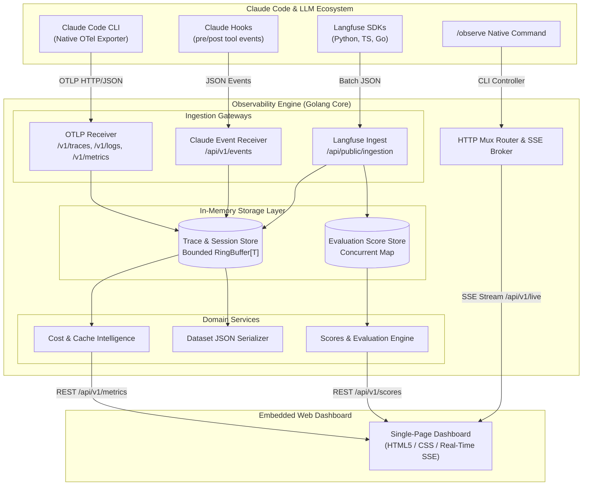

<div align="center">

# 🔭 Claude Code Observability
### *The Open-Source Tracing, Cost Intelligence & Telemetry Engine for Claude Code*

[](https://golang.org)
[](LICENSE)
[](file:///c:/Desktop/observability-system)
[](#performance--footprint)
[](#performance--footprint)
[](#why-claude-code-observability)

**A high-performance, local-first alternative to Langfuse built specifically for Anthropic's Claude Code CLI.**  
Trace multi-turn agent sessions, inspect tool execution trees (`bash`, `file_edit`, `glob`), track prompt cache savings, evaluate runs with qualitative scores, and visualize everything in an embedded real-time web dashboard.

[Features](#-key-features) • [Quickstart](#-quickstart) • [Claude Code Integration](#-claude-code-native-integration) • [Architecture](#-architecture) • [API Reference](#-api-reference)

---

</div>

## UI Demo


## 💡 Why Claude Code Observability?

Anthropic's **Claude Code** is one of the most capable agentic coding tools in developer workflows. However, running autonomous agents locally introduces new challenges:
- **Token Runaways & Cost Blindness**: Multi-turn prompts and subagent task loops can consume millions of tokens before you notice.
- **Prompt Cache Invisibility**: Anthropic provides massive prompt cache discounts (up to 90%), but developers rarely know how much they actually saved.
- **Tool Execution Black Box**: When Claude runs `bash`, modifies files, or chains tools, debugging failures across deep agent trees is cumbersome.
- **Privacy & Cloud Vendor Lock-In**: Sending proprietary source code traces to third-party SaaS observability vendors introduces compliance and data exfiltration concerns.

**Claude Code Observability** solves this with a **single, dependency-free binary** written in pure Golang. It boots in under 10ms, consumes less than 15MB of RAM, and runs 100% locally on your machine with zero external databases or telemetry cloud accounts required.

---

## ⚡ Key Features

| Capability | Description |
|---|---|
| 🌲 **Trace Waterfall & Spans** | Complete visualization of agent turns, nested sub-calls, tool inputs/outputs, and LLM generations. |
| 💰 **Prompt Cache Economics** | Live calculation of input, output, and cache-read tokens with exact Anthropic USD pricing and prompt cache savings. |
| 🛠️ **Deep Tool Call Inspection** | Syntax-highlighted inputs, outputs, and exit codes for `bash`, `file_edit`, `glob`, `read_file`, and custom tools. |
| ⭐ **Langfuse-Compatible Scores** | Rate agent runs with qualitative scores (1-5 stars, pass/fail, commentary) for benchmarking and RLHF datasets. |
| 📦 **Multi-Protocol Ingestion** | Drop-in support for OpenTelemetry OTLP (`/v1/traces`, `/v1/logs`, `/v1/metrics`), Claude hooks (`/api/v1/events`), and Langfuse batch SDK payloads (`/api/public/ingestion`). |
| ⚡ **Sub-10ms Startup & <15MB RAM** | Bounded circular ring buffers with zero garbage collection overhead and zero external databases (no PostgreSQL or ClickHouse needed). |
| 🖥️ **Embedded Real-Time UI** | Zero npm or Node.js runtime required; a lightweight HTML5/SSE dashboard is baked directly into the Go binary. |
| 📥 **One-Click Dataset Export** | Export recorded traces, sessions, and evaluation scores directly into standard JSON datasets. |

---

## 🚀 1-Step Installation (Claude Code Plugin)

Install directly as an official Claude Code plugin:

```bash
# Inside Claude Code:
/plugin install agent-observability
/plugin install agent-observability --marketplace sundaram2021/claude-code-observability-system

# Or from your terminal:
claude plugin install agent-observability
```

> **Zero Configuration & Seamless Lifecycle**:
> - **Auto-Start**: Whenever you launch Claude Code, the backend server quietly starts on `http://localhost:3456`.
> - **Auto-Stop**: When you exit Claude Code (`/exit` or Ctrl+C), the server terminates automatically, freeing port 3456 and all memory.
> - **Direct Bundling**: Precompiled native binaries for Windows (`x64`), macOS (`Apple Silicon` & `Intel`), and Linux (`x64`) are bundled directly—no Go or compiler toolchain needed.

---

## 🛠️ Standalone Binary Quickstart (Optional)

### 1. Download or Build the Binary

```bash
# Clone the repository
git clone https://github.com/sundaram2021/claude-code-observability-system.git
cd claude-code-observability-system

# Build optimized single binary (6.6MB)
go build -ldflags "-s -w" -o bin/server.exe ./cmd/server
```

### 2. Start the Daemon

```bash
# Start in the background (detached)
./bin/server.exe start

# Check real-time status and metrics
./bin/server.exe status

# Open the embedded dashboard in your browser
./bin/server.exe open
```

---

## 🔌 Claude Code Native Integration

### Automatic Telemetry (Zero Configuration)

Claude Code features built-in OpenTelemetry export. To automatically route all traces, logs, and metrics into your local observability server, add the following to your user settings (`~/.claude/settings.json`):

```json
{
  "env": {
    "CLAUDE_CODE_ENABLE_TELEMETRY": "1",
    "OTEL_METRICS_EXPORTER": "otlp",
    "OTEL_LOGS_EXPORTER": "otlp",
    "OTEL_EXPORTER_OTLP_PROTOCOL": "http/json",
    "OTEL_EXPORTER_OTLP_ENDPOINT": "http://localhost:3456",
    "OTEL_EXPORTER_OTLP_TRACES_ENDPOINT": "http://localhost:3456/v1/traces"
  }
}
```

Now, simply start Claude Code in any terminal:
```bash
claude
```
Every tool execution, LLM turn, token metric, and cache hit will stream live to `http://localhost:3456`!

---

### Native Slash Command (`/observe`)

The repository includes a ready-to-use Claude Code custom command in [`.claude/commands/observe.md`](file:///.claude/commands/observe.md). Inside any Claude Code conversation, you can type:

```text
/observe
```

* **`/observe`** — Verifies or starts the background daemon and opens the live dashboard.
* **`/observe status`** — Displays token counts, prompt cache savings, and tool success rates inside the CLI.
* **`/observe open`** — Launches or refocuses `http://localhost:3456` in your default browser.
* **`/observe export`** — Exports traces and scores to a JSON dataset.

---

## 🏛️ Architecture & Clean Design

The system is engineered according to **SOLID**, **DRY**, and **YAGNI** principles with a strict rule that **no single source file exceeds 200 lines of code**.



---

## 📊 Feature Comparison: Claude Code Observability vs. Langfuse

| Feature | Claude Code Observability | Langfuse (Self-Hosted) |
|---|---|---|
| **Language & Runtime** | Pure Go (Single 6.6MB binary) | Node.js / Next.js / Python |
| **Dependencies** | **Zero** (Zero external databases) | PostgreSQL, ClickHouse, Redis, MinIO |
| **Startup Time** | **< 10 ms** | 30 - 60 seconds (Docker compose) |
| **RAM Consumption** | **< 15 MB** | 1.5 GB - 4 GB |
| **Claude Code `/observe`** | **Native Built-in** | Manual setup / proxy |
| **Prompt Cache Economics** | **First-Class** (Exact Anthropic pricing) | Basic token counting |
| **OTLP Support** | Native `/v1/traces`, `/v1/logs`, `/v1/metrics` | Via OpenTelemetry collector |
| **Langfuse Batch SDK API** | Drop-in compatible (`/api/public/ingestion`) | Native |
| **Qualitative Evaluations** | Built-in Scores & Annotation Modal | Built-in |
| **Data Privacy** | 100% Local on developer's machine | Self-hosted or Cloud SaaS |

---

## 📡 API Reference

### Ingestion Endpoints
- `POST /v1/traces` — OpenTelemetry OTLP/HTTP traces payload.
- `POST /v1/logs` — OpenTelemetry OTLP/HTTP logs payload.
- `POST /v1/metrics` — OpenTelemetry OTLP/HTTP metrics payload.
- `POST /api/v1/events` — Native Claude Code hook event format.
- `POST /api/public/ingestion` — Langfuse SDK batch ingestion format.

### Query & Management Endpoints
- `GET /api/v1/traces` — List traces with filtering (`search`, `status`, `sessionId`, `limit`).
- `GET /api/v1/traces/{id}` — Fetch detailed trace with full span hierarchy.
- `DELETE /api/v1/traces` — Clear in-memory trace buffer.
- `GET /api/v1/sessions` — List grouped user sessions and turns.
- `GET /api/v1/metrics` — Real-time metrics (tokens, costs, cache savings, latency, error rates).
- `POST /api/v1/scores` — Create a qualitative score/evaluation for a trace.
- `GET /api/v1/scores` — Retrieve all scores.
- `GET /api/v1/traces/export` — Export entire database as downloadable JSON dataset.
- `GET /api/v1/live` — Server-Sent Events (SSE) stream for real-time dashboard updates.

---

## 🧪 Testing & Verification

The project includes unit, repository, and end-to-end integration tests:

```bash
# Run all tests with coverage
go test -v -cover ./...

# Package test coverage highlights:
# internal/domain:       100.0%
# internal/config:       100.0%
# web:                   100.0%
# internal/agent:         98.3%
# internal/repository:    95.4%
# internal/service:       94.2%
# internal/handler:       91.1%
# internal/ingestion:     90.5%
```

---

## 👤 Author & Maintainer

**Sundaram Kumar Jha** ([jhasundarm@gmail.com](mailto:jhasundarm@gmail.com))

---

## 📄 License

This project is licensed under the MIT License — see the [LICENSE](LICENSE) file for details.
