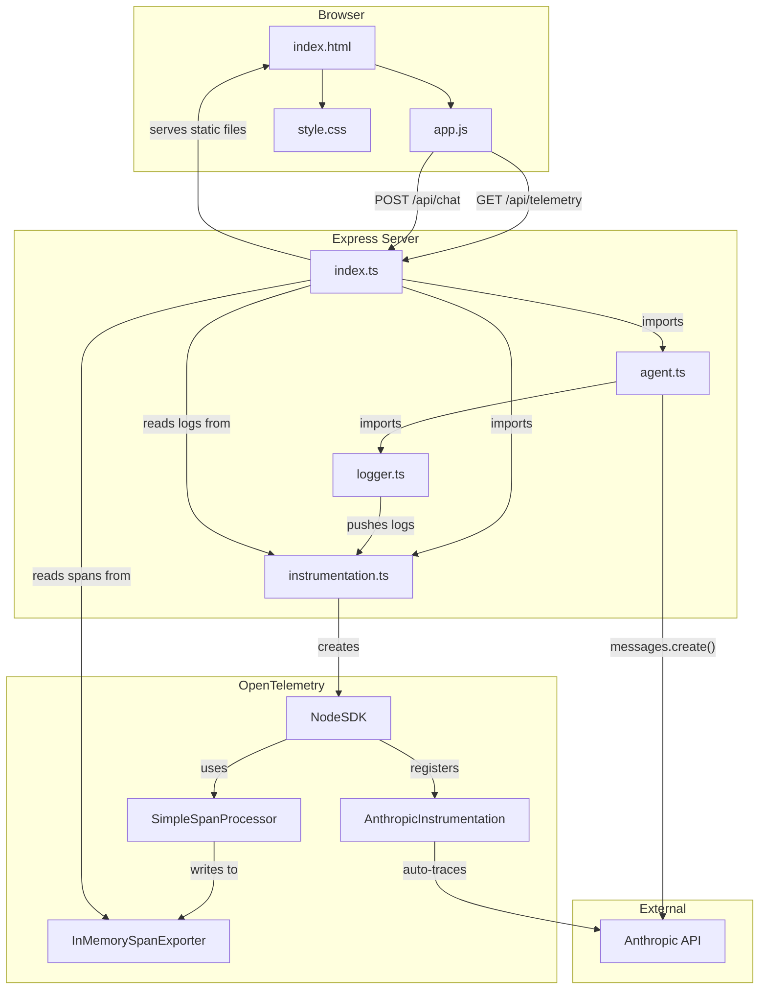

# LLM Observability System

A self-hosted observability platform for LLM-powered agents. It traces every Anthropic API call and tool execution using OpenTelemetry, stores everything in memory, and renders a live dashboard in the browser — no external services needed.

## Demo


## Architecture




### Backend (`src/`)

| File | What it does |
|------|-------------|
| `src/index.ts` | Express server entry point. Serves the static frontend, exposes `POST /api/chat` to send messages to Claude, and `GET /api/telemetry` to return collected spans and logs as JSON. |
| `src/instrumentation.ts` | Initializes the OpenTelemetry SDK with an in-memory span exporter and the Anthropic auto-instrumentation. Every Anthropic API call gets traced automatically. Also holds the shared `memoryLogStore` array. |
| `src/services/agent.ts` | The chat agent. Sends user messages to Claude with two tools (`get_date`, `calculator`), handles the tool-use loop, and wraps each tool execution in its own OTel span. |
| `src/utils/logger.ts` | Simple logger that pushes structured log entries (with trace correlation) into the shared `memoryLogStore` so they show up on the dashboard. |


## Setup

```bash
# 1. Clone and install
git clone <repo-url>
cd llm-observability-system
pnpm install

# 2. Add your Anthropic API key
echo ANTHROPIC_API_KEY=sk-ant-... > .env.local

# 3. Start the server
pnpm dev

# 4. Open the dashboard
# http://localhost:3000

# 5. Send a chat message (from another terminal)
curl -X POST http://localhost:3000/api/chat \
  -H "Content-Type: application/json" \
  -d '{"message": "What is 42 * 17?"}'

# 6. Watch the dashboard update with traces and spans
```

## Concepts

