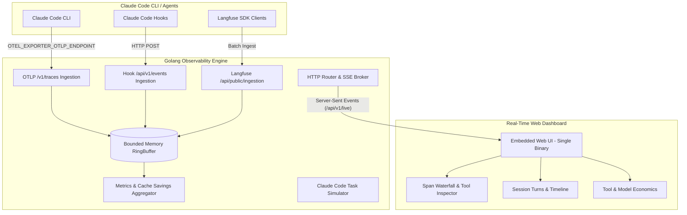

# Claude Code Observability (Langfuse for Claude Code)

A high-performance, self-hosted observability platform designed specifically for **Anthropic's Claude Code CLI** and LLM agent workflows, built entirely in **Golang**.

It traces agent turns, tool executions (`bash`, `file_edit`, `glob`, `view`), LLM generations, token usage, latency, and costs — with real-time prompt cache savings tracking and a live waterfall dashboard.

---

## Architecture



---

## Key Features

1. **Native OpenTelemetry (OTel) Support (`/v1/traces`)**:
   Point Claude Code CLI directly to the server using standard OTel environment variables.
2. **Claude Code Hooks & Transcript Ingestion (`/api/v1/events`)**:
   Directly stream pre-tool, post-tool, and turn events from Claude Code hooks.
3. **Langfuse Ingestion API Compatibility (`/api/public/ingestion`)**:
   Drop-in replacement for Langfuse batch trace and span ingestion.
4. **Prompt Cache Savings Calculator**:
   Tracks input, output, cache creation, and cache read tokens. Automatically computes dollars saved through Claude 3.5 & 3.7 prompt caching.
5. **Waterfall Trace Visualizer & Tool Inspector**:
   Interactive drill-down into tool executions: bash commands, exit codes, file edits, and raw payloads.
6. **Session & Timeline Explorer**:
   Groups traces by Claude Code session and repository directory.
7. **Ultra-Low Memory Footprint**:
   Implemented with bounded zero-leak circular ring buffers (`RingBuffer[T]`), lean structs, and zero heavy dependencies. Operates in < 15MB RAM.
8. **Single Binary Deployment**:
   Web assets are embedded via Go `embed.FS`.

---

## Quickstart

### 1. Run the Server
```bash
# Build and run
go run ./cmd/server
# Or using the built binary
./bin/server.exe
```

The server starts at `http://localhost:3000`.

### 2. Connect Claude Code CLI
In your terminal, set the OpenTelemetry endpoint before running Claude Code:

```bash
# Linux / macOS
export OTEL_EXPORTER_OTLP_ENDPOINT="http://localhost:3000/v1/traces"
export OTEL_EXPORTER_OTLP_PROTOCOL="http/json"
claude "Refactor auth middleware and run tests"

# Windows PowerShell
$env:OTEL_EXPORTER_OTLP_ENDPOINT="http://localhost:3000/v1/traces"
$env:OTEL_EXPORTER_OTLP_PROTOCOL="http/json"
claude "Refactor auth middleware and run tests"
```

### 3. Open the Dashboard
Open `http://localhost:3000` in your browser. Watch spans and metrics stream in real time via Server-Sent Events (SSE)!
You can also click **"+ Simulate Task"** in the dashboard to generate test Claude Code agent runs.

---

## API Endpoints

| Endpoint | Method | Description |
|---|---|---|
| `/v1/traces` | `POST` | OpenTelemetry standard OTLP/HTTP traces receiver |
| `/api/v1/events` | `POST` | Claude Code hook events receiver |
| `/api/public/ingestion` | `POST` | Langfuse batch ingestion compatibility receiver |
| `/api/v1/traces` | `GET`, `POST`, `DELETE` | List, create, or clear stored traces |
| `/api/v1/traces/{id}` | `GET` | Get trace waterfall tree with nested spans |
| `/api/v1/sessions` | `GET` | List Claude Code sessions with summaries |
| `/api/v1/sessions/{id}` | `GET` | Get session details and associated turns |
| `/api/v1/metrics` | `GET` | Aggregated metrics, cache savings, and tool stats |
| `/api/v1/agent/run` | `POST` | Run or simulate a Claude Code agent task |
| `/api/v1/live` | `GET` | Server-Sent Events (SSE) live stream |
